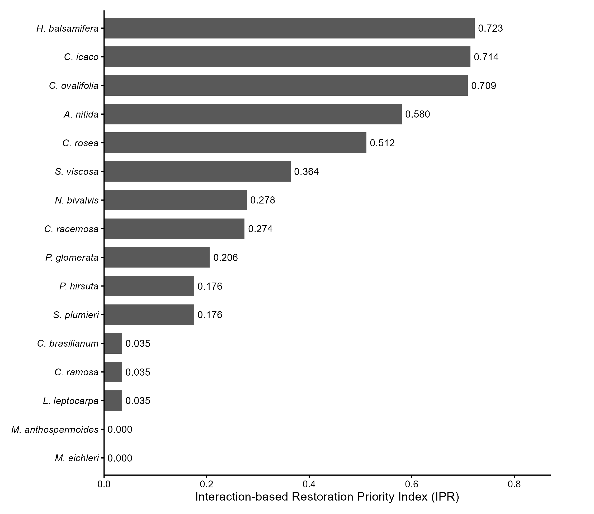

---

title: "restaurabee: An R package for interaction-based ecological restoration prioritization"

tags:

* R
* ecology
* ecological restoration
* plant–pollinator networks
* ecological networks
* biodiversity conservation

authors:

* name: Emerson Dechechi Chambó
  affiliation: 1
  orcid: 0000-0003-3507-3106

* name: Miriam Monteiro Costa
  affiliation: 1
  orcid: 0000-0002-0360-3435

* name: Raissa Castro Nunes
  affiliation: 1
  orcid: 0009-0003-6134-1247

* name: Wesley Lopes Vilela
  affiliation: 1
  orcid: 0009-0006-5737-2157

* name: Ryan Mota Mendes
  affiliation: 1
  orcid: 0009-0004-4344-8515

* name: Edmilson Santos Silva
  affiliation: 1
  orcid: 0000-0002-5931-2477

* name: Carlos Alfredo Lopes de Carvalho
  affiliation: 1
  orcid: 0000-0002-3306-3003

affiliations:

* name: Universidade Federal do Recôncavo da Bahia (UFRB), Cruz das Almas, Bahia, Brazil
  index: 1

date: 2026-06-05

## bibliography: paper.bib

# Summary

Ecological restoration increasingly recognizes that recovering species interactions is as important as restoring species richness for re-establishing ecosystem functioning. Plant–pollinator interaction networks provide valuable information on species roles within ecological communities and offer a quantitative basis for restoration planning and biodiversity conservation.

`restaurabee` is an R package that implements a complete and reproducible workflow for prioritizing plant species for ecological restoration using plant–pollinator interaction networks. The package transforms raw interaction records into restoration-priority rankings by integrating standardized interaction abundance, occurrence frequency, connectivity, and species specialization into the Interaction-based Restoration Priority Index (IPR).

The workflow automates data validation, interaction matrix construction, calculation of species- and network-level ecological metrics, restoration-priority ranking, cumulative species selection, sensitivity analysis, and network characterization. By integrating these analytical steps into a single analytical framework, `restaurabee` reduces methodological complexity while improving transparency, reproducibility, and consistency in restoration decision-making.

The package is intended for restoration ecologists, conservation biologists, biodiversity researchers, and environmental practitioners interested in incorporating ecological interaction networks into restoration planning.

# Statement of Need

Ecological restoration aims not only to recover species richness but also to restore the ecological processes that sustain ecosystem functioning. Among these processes, pollination plays a central role by supporting plant reproduction, maintaining genetic diversity, and promoting ecosystem resilience. Consequently, restoring plant–pollinator interactions has become a major objective of contemporary restoration ecology [@Menz2011].

Ecological interaction networks have become powerful tools for understanding species roles within biological communities and supporting conservation planning. For example, plant–pollinator networks have been successfully incorporated into spatial conservation planning to identify priority areas for biodiversity protection, highlighting that preserving ecological interactions is as important as conserving species richness [@Pereira2022]. Likewise, network-based metrics have been widely used to quantify the relative importance of species and their contributions to community structure, ecological stability, and ecosystem functioning [@Bascompte2007; @Bluthgen2024].

Despite these advances, translating ecological network descriptors into practical restoration recommendations at the species level remains challenging. Existing analytical workflows typically require researchers to calculate multiple network metrics using different software packages and subsequently integrate the results manually. This fragmented process increases methodological complexity, reduces reproducibility, and limits the routine application of ecological network analyses in restoration planning.

`restaurabee` was developed to address this gap by providing a complete and reproducible workflow for prioritizing plant species for ecological restoration based on plant–pollinator interaction networks. The package integrates data validation, interaction matrix construction, calculation of species- and network-level ecological metrics, restoration-priority ranking through the Interaction-based Restoration Priority Index (IPR), cumulative species selection, sensitivity analysis, and network characterization within a single analytical framework.

# State of the Field

Several R packages provide powerful tools for ecological network analysis. The package `bipartite` offers a comprehensive suite of species- and network-level metrics for bipartite ecological networks, including specialization, nestedness, modularity, interaction diversity, and robustness [@Dormann2008]. The package `igraph` provides a flexible framework for graph representation, visualization, and network analysis across diverse applications [@Csardi2006], whereas `vegan` implements a broad collection of methods for community ecology, ordination, diversity analysis, and multivariate statistics [@Oksanen2026].

These packages have become fundamental tools in ecological research and provide the methodological foundation for many studies involving ecological networks. However, none was specifically developed to support restoration-oriented species prioritization. Consequently, researchers must typically calculate multiple ecological descriptors independently, integrate outputs from different packages, standardize variables, define weighting schemes, and develop custom ranking procedures before obtaining restoration recommendations.

Ecological interaction networks have also been incorporated into restoration and conservation planning. For example, Borges et al. [@Borges2025] developed a framework that combines interaction-network information and species functional traits to identify priority plant and bee species for tropical forest restoration. Likewise, Pereira et al. [@Pereira2022] proposed a network-based framework for identifying priority areas for biodiversity conservation using plant–pollinator interaction networks. These studies demonstrate the growing importance of ecological interaction networks as decision-support tools for conservation and restoration. However, both approaches were developed for specific applications and were not implemented as reusable software capable of providing a standardized and reproducible analytical workflow for restoration-oriented species prioritization.

Rather than replacing existing ecological network packages, `restaurabee` builds upon well-established analytical methods and integrates them into a restoration-oriented workflow. The package combines data validation, interaction matrix construction, species- and network-level ecological metrics, the Interaction-based Restoration Priority Index (IPR), cumulative species selection, and sensitivity analysis into a single reproducible framework. By automating these analytical steps, `restaurabee` transforms plant–pollinator interaction data into transparent restoration-priority rankings while maintaining compatibility with established ecological network analyses.

# Software Design

`restaurabee` adopts a modular architecture in which each analytical component is implemented as an independent function. This design facilitates code maintenance, testing, transparency, and future methodological extensions while allowing users to access intermediate results throughout the analytical workflow.

The workflow begins with validation of the input data, followed by construction of a quantitative plant–pollinator interaction matrix. Species-level ecological metrics are then calculated, including interaction abundance, occurrence frequency, partner richness (connectivity), and the Interaction Importance Index (IIP). Species specialization (d') is subsequently estimated using methods implemented in the `bipartite` package [@Bluthgen2006; @Dormann2008]. Network-level descriptors are also obtained directly from `bipartite`, allowing users to characterize the overall structure of the interaction network.

To generate restoration priorities, the package combines standardized interaction abundance, occurrence frequency, connectivity, and species specialization (d') into the Interaction-based Restoration Priority Index (IPR). Prior to aggregation, all variables are normalized using min–max scaling to ensure comparability among ecological metrics.

Species specialization is incorporated as an independent ecological component because it captures interaction selectivity that is not represented by abundance, occurrence frequency, or connectivity alone. Whereas connectivity reflects the number of pollinator partners, specialization (d') describes how selectively a plant interacts relative to partner availability. Including both metrics enables the IPR to balance species supporting numerous interactions with species contributing comparatively specialized interactions, while avoiding the conceptual redundancy that could arise from representing generalism simultaneously through connectivity and (1-d').

By default, the four ecological components receive equal weights, representing a balanced prioritization strategy in the absence of evidence supporting differential weighting. Nevertheless, users may specify alternative weighting schemes according to specific restoration objectives or ecological hypotheses, thereby adjusting the relative contribution of each ecological component to the final restoration-priority ranking. To evaluate the robustness of prioritization results, `restaurabee` performs a sensitivity analysis that compares alternative ranking scenarios using Spearman rank correlations.

The package is implemented entirely in R [@RCoreTeam2025] and is centered on the `restaurabee()` function, which orchestrates the complete analytical workflow. The function returns a structured object containing metadata, interaction matrices, species-level metrics, restoration-priority rankings, selected species, sensitivity-analysis results, and network-level descriptors, allowing both rapid interpretation and detailed downstream analyses.

Figure 1 summarizes the analytical workflow implemented in `restaurabee`.

# Research Impact Statement

To demonstrate the application of `restaurabee`, we analyzed a plant–pollinator interaction network from coastal restinga vegetation in northeastern Brazil. The empirical dataset comprised 79 recorded interaction events involving 16 plant species, 13 bee species, and 26 sampling units.

The complete analytical workflow was executed using a single call to the `restaurabee()` function. The package automatically validated the input data, constructed the quantitative interaction matrix, calculated the Interaction Importance Index (IIP), estimated species specialization (d'), computed the Interaction-based Restoration Priority Index (IPR), selected priority species according to a cumulative restoration threshold, performed sensitivity analyses under alternative weighting schemes, and estimated structural properties of the interaction network.

Table 1 summarizes the seven plant species automatically selected by `restaurabee` using the default cumulative restoration threshold (80%). In addition to the final Interaction-based Restoration Priority Index (IPR), the table presents the Interaction Importance Index (IIP) together with the relative and cumulative priorities used by the algorithm during species selection.

Table 1: Plant species selected by `restaurabee` using the default cumulative restoration threshold (80%).

| Rank | Plant species    |   IIP |   IPR | Relative priority (%) | Cumulative priority (%) |
| ---: | ---------------- | ----: | ----: | --------------------: | ----------------------: |
|    1 | *H. balsamifera* | 0.147 | 0.723 |                 15.01 |                   15.01 |
|    2 | *C. icaco*       | 0.143 | 0.714 |                 14.83 |                   29.84 |
|    3 | *C. ovalifolia*  | 0.141 | 0.709 |                 14.72 |                   44.56 |
|    4 | *A. nitida*      | 0.116 | 0.580 |                 12.05 |                   56.61 |
|    5 | *C. rosea*       | 0.101 | 0.512 |                 10.62 |                   67.23 |
|    6 | *S. viscosa*     | 0.042 | 0.364 |                  7.55 |                   74.79 |
|    7 | *N. bivalvis*    | 0.056 | 0.278 |                  5.78 |                   80.57 |

Figure 2 illustrates the restoration-priority ranking generated by `restaurabee` for all plant species in the empirical network.

Using the default cumulative threshold of 80%, `restaurabee` automatically selected seven plant species, which together accounted for approximately 80.6% of the cumulative restoration priority. This objective criterion enables practitioners to identify a minimum set of species accounting for a predefined proportion of the total restoration-priority value while providing a transparent criterion for species selection.

The analyzed interaction network exhibited a connectance of 0.178 and a network specialization (H2′) of 0.448, indicating an intermediate level of ecological specialization. Sensitivity analyses demonstrated high robustness of the prioritization procedure, with a mean Spearman rank correlation of 0.980 among alternative weighting scenarios (range: 0.964–0.997), indicating that restoration priorities remained highly consistent despite changes in the relative importance assigned to each ecological component.

Beyond generating restoration-priority rankings, `restaurabee` returns interaction matrices, species-level ecological metrics, specialization indices, cumulative prioritization tables, sensitivity-analysis outputs, and network-level descriptors within a structured object. These outputs facilitate both restoration planning and subsequent ecological-network analyses using a single reproducible workflow.

By integrating established ecological-network methods with a restoration-oriented prioritization framework, `restaurabee` provides an accessible, transparent, and reproducible tool for incorporating plant–pollinator interactions into ecological restoration planning.

# AI Usage Disclosure

AI tools were used for language refinement, text organization, and formatting only. All scientific and technical content—including the conceptual framework, methodological design, software architecture and implementation, ecological metrics, prioritization framework, analyses, interpretation of results, and citations—was conceived, implemented, verified, and authored by the human authors, who take full responsibility for the manuscript and software. No AI-generated results, unreviewed source code, or unverified citations were included; all software outputs, analyses, and references were checked by the authors.

# Acknowledgements

The authors thank the Universidade Federal do Recôncavo da Bahia (UFRB).

The authors also acknowledge the PPBio Restinga Beira-Mar Network (Brazilian Biodiversity Research Program; CNPq Grant No. 441250/2023-8) for providing the ecological dataset used to demonstrate the application of `restaurabee`.

MMC acknowledges the Coordenação de Aperfeiçoamento de Pessoal de Nível Superior (CAPES), Brazil (Finance Code 001), for financial support.

# References 
